# 🌍 Awesome 3D Geospatial & Mapping Platforms

  

  
  
  
  
  
  

  <b>A comprehensive, curated catalog of leading SaaS platforms and top open-source GitHub projects for 3D Geospatial Mapping, Digital Twins, WebGIS, and Spatial Data Analytics.</b> 
  <i>Covering Interactive 3D Globes, OGC 3D Tiles, Terrain Meshes, LiDAR Point Clouds, Photogrammetry, and Spatial Indexing.</i>

---

## 🧭 Table of Contents

- [📊 Sector Overview & Market Dynamics](#-sector-overview--market-dynamics)
- [☁️ SaaS/Hosted Platforms](#️-saashosted-platforms)
- [🔓 Open-Source GitHub Projects](#-open-source-github-projects)
  - [Ranked by GitHub Stargazers](#ranked-by-github-stargazers)
  - [Architecture & Tech Stack Recommendations](#architecture--tech-stack-recommendations)
- [📈 Star History](#-star-history)
- [🤝 How to Contribute](#-how-to-contribute)
- [💖 Support](#-support)
- [📜 Disclaimer](#-disclaimer)

---

## 📊 Sector Overview & Market Dynamics

The global 3D geospatial mapping and modeling market is estimated at approximately **$10B to $18B in 2026**, expanding at a robust double-digit compound annual growth rate (**CAGR of 10%–14%**) fueled by digital twin initiatives, smart cities, cloud GIS infrastructure, and autonomous spatial workflows. The sector is **moderately fragmented** rather than winner-take-all: traditional enterprise leaders (Esri, Trimble, Hexagon, Bentley) anchor public-sector, surveying, and engineering domains, while high-growth cloud-native and space-tech platforms (Planet Labs, Mapbox, Cesium ion, CARTO) capture specialized segments in web tiling, streaming APIs, satellite observation, and warehouse-native spatial intelligence.

---

## ☁️ SaaS/Hosted Platforms

| Platform | Company Scale (Valuation / Revenue) | Starting Pricing | Free Tier Limits | Description |
| :--- | :--- | :--- | :--- | :--- |
| **[Google Earth Enterprise / Maps Platform](https://earth.google.com/)** | ~$2.0T+ Market Cap (Alphabet) / $350B+ Rev | $6.00 per 1,000 requests (Photorealistic 3D Tiles) | 1,000 root tile requests free per month (along with $200 monthly recurring Maps credit) | Enterprise-grade 3D globe and geospatial visualization platform with high-resolution imagery, terrain, and custom data layering (historically available for on-premises deployment). |
| **[Hexagon Geospatial](https://www.hexagon.com/products/product-groups/geospatial)** | ~$26B Market Cap (SEK 279B) / €5.4B Rev | Custom enterprise licensing (HxGN Content streaming tiers vary) | 10-day free trial (HxGN Content Program aerial imagery streaming) & free trial access for Luciad Developer Platform APIs | Enterprise geospatial and remote-sensing platform for imagery management, photogrammetry, and 3D mapping workflows. |
| **[Trimble Cloud](https://www.trimble.com/)** | ~$14B Market Cap / $3.8B Rev | $10.00 / user / month (Trimble Connect Business) | Free forever (Trimble Connect Personal: 1 active project, up to 5 team members, 10 GB cloud storage) | Cloud services and geospatial solutions for surveying, construction, and 3D reality capture integrated with Trimble hardware and software. |
| **[Bentley Systems](https://www.bentley.com/)** | ~$10.8B Market Cap / $1.5B ARR | $199.00 / month (iTwin Platform Standard tier) | Free forever (iTwin Community: 100 credits/month, 10 GB cloud storage, 100 GB reality data storage; 30-day free trial for iTwin Capture) | Infrastructure engineering software suite with strong 3D reality modeling, digital twin, and geospatial visualization capabilities (ContextCapture, iTwin, etc.). |
| **[Planet Labs](https://www.planet.com/)** | ~$6.0B Market Cap / $308M Rev | $2,700.00 / year (~$225.00/month baseline monitoring packages) | 30-day free trial (Planet Insights Platform: 3,000 monitoring credits, Sentinel/Landsat access, sandbox datasets; no credit card required) | Satellite imagery and analytics platform providing frequent global coverage and APIs for monitoring change on Earth. |
| **[Esri ArcGIS Enterprise](https://www.esri.com/en-us/arcgis/products/arcgis-enterprise/overview)** | ~$4.0B+ Private Valuation / $1.3B Rev | $500.00 / user / year (~$41.67/month for ArcGIS Online Creator) | 21-day free trial (ArcGIS Online: includes 200 service credits, up to 5 named users, and full app suite access) | Comprehensive enterprise GIS platform with powerful 3D scene capabilities, I3S scene layers, 3D Tiles support, analysis tools, and multi-user collaboration. |
| **[Mapbox Enterprise](https://www.mapbox.com/)** | ~$1.3B Valuation (Series E) / ~$150M+ ARR | Pay-as-you-go starting at $5.00 per 1,000 loads beyond free tier | Free forever (50,000 web map loads/month, 100,000 Geocoding/Directions API requests/month, 25,000 mobile MAUs) | High-performance vector and 3D mapping platform with custom styling, terrain, building extrusions, and enterprise SLAs for web and mobile applications. |
| **[Nearmap](https://www.nearmap.com/)** | ~$700M Acquisition Valuation (AUD $1.055B) / ~$160M Rev | Custom enterprise quote (typically $2,000+ to $5,000+ annual subscription minimum) | Guided evaluation access & free product demo upon sales request (no permanent free tier or automated self-serve trial) | High-resolution aerial imagery and 3D content platform focused on frequent updates for urban and infrastructure use cases. |
| **[Carto](https://carto.com/)** | ~$350M–$500M Est. Valuation / ~$55M Rev | Custom enterprise tier / commitments (~$10,000+/year typical enterprise package) | 30-day free trial (Full platform functionality, Builder access, cloud warehouse connections; no credit card required) | Cloud-native location intelligence and spatial analytics platform with strong visualization and data enrichment capabilities. |
| **[Cesium ion](https://cesium.com/platform/cesium-ion/)** | Integrated into Bentley Systems ($10.8B) / ~$7.4M historical rev | $149.00 / month (Commercial Individual plan) | Free forever (Cesium ion Community: non-commercial evaluation, 5 GB storage, global terrain & imagery streaming access) | Cloud platform for tiling, hosting, and streaming 3D geospatial content (terrain, imagery, 3D Tiles, photogrammetry) optimized for CesiumJS and other clients. |

---

## 🔓 Open-Source GitHub Projects

The 3D geospatial web ecosystem features an extraordinary suite of mature open-source tools. Below is an expanded list of top open-source repositories, sorted in descending order by GitHub stargazer count.

### Ranked by GitHub Stargazers

- **[CesiumJS](https://github.com/CesiumGS/cesium)**   
  Leading open-source JavaScript library for creating world-class 3D globes and 2D maps in a web browser using WebGL and WebGPU. Reference implementation for OGC 3D Tiles, terrain, time-dynamic data, CZML, glTF, and massive geospatial datasets (Apache 2.0).

- **[deck.gl](https://github.com/visgl/deck.gl)**   
  High-performance WebGL2/WebGPU powered data visualization framework designed for large-scale exploratory data analysis and 3D geospatial visual analytics (often paired with MapLibre or Cesium).

- **[QGIS](https://github.com/qgis/QGIS)**   
  Leading open-source desktop Geographic Information System (GIS) with native 3D visualization canvas, 3D Tiles support, point cloud handling, and an extensive ecosystem of analysis plugins.

- **[OpenLayers](https://github.com/openlayers/openlayers)**   
  Mature, high-performance web mapping library supporting OGC standards, vector tiles, projections, and rich 2D/2.5D geospatial visualization across web and mobile browsers.

- **[kepler.gl](https://github.com/keplergl/kepler.gl)**   
  Data-agnostic, high-performance web-based spatial analysis application built on top of deck.gl for interactive rendering of massive multi-million point 2D and 3D location datasets.

- **[MapLibre GL JS](https://github.com/maplibre/maplibre-gl-js)**   
  Community-governed open-source fork of Mapbox GL JS providing ultra-fast client-side vector maps, 3D terrain elevation, building extrusions, and globe projection views without proprietary licensing.

- **[H3](https://github.com/uber/h3)**   
  Hexagonal hierarchical spatial index developed by Uber for grid-based spatial aggregation, geospatial partitioning, and fast hexagonal 3D spatial analytics across planetary scales.

- **[OpenDroneMap (ODM)](https://github.com/OpenDroneMap/ODM)**   
  Open-source photogrammetry pipeline for processing aerial drone imagery into georeferenced orthophotos, digital elevation models (DEM), 3D point clouds, and textured 3D meshes.

- **[GDAL](https://github.com/OSGeo/gdal)**   
  The foundational translator library for raster and vector geospatial data formats, underpinning virtually the entire geospatial software and 3D GIS industry.

- **[Potree](https://github.com/potree/potree)**   
  Leading open-source WebGL point cloud renderer designed specifically for streaming and rendering billions of LiDAR points and massive photogrammetry scans directly in web browsers.

- **[GeoServer](https://github.com/geoserver/geoserver)**   
  Java-based open-source software server that allows users to share, process, and edit geospatial data across open standards such as WMS, WFS, WCS, and 3D Tiles.

- **[3d-tiles-renderer](https://github.com/NASA-AMMOS/3DTilesRendererJS)**   
  Three.js-based renderer for OGC 3D Tiles developed by NASA-AMMOS, enabling efficient hierarchical Level of Detail (LOD) streaming and rendering of massive 3D geospatial content.

- **[PostGIS](https://github.com/postgis/postgis)**   
  Spatial database extender for PostgreSQL that adds native support for spatial geometries, 3D point clouds, spatial indexing, and advanced spatial SQL functions.

- **[osgEarth](https://github.com/gwaldron/osgearth)**   
  High-performance open-source C++ 3D terrain and geospatial rendering SDK built on OpenSceneGraph, widely deployed in desktop simulators, defense, and embedded GIS systems.

- **[PDAL](https://github.com/PDAL/PDAL)**   
  Point Data Abstraction Library (C++), providing composable command-line tools and C++ APIs for translating, filtering, tiling, and transforming massive point cloud (LiDAR) datasets.

- **[TerriaJS](https://github.com/TerriaJS/terriajs)**   
  Open-source framework for building rich web-based spatial data catalogs, digital twins, and federated 3D mapping portals (powers Australia's NationalMap).

- **[Procedural GL JS](https://github.com/felixpalmer/procedural-gl-js)**   
  Fast, lightweight WebGL library for rendering 3D terrain and elevation maps with mobile-friendly controls and smooth camera navigation.

- **[harp.gl](https://github.com/heremaps/harp.gl)**   
  3D web map rendering engine developed by HERE Technologies based on Three.js, supporting 3D buildings, terrain, and custom styling.

- **[iTowns](https://github.com/iTowns/itowns)**   
  Three.js-based framework for visualizing 3D geospatial data, including 3D Tiles, point clouds, raster layers, and atmospheric models.

- **[Cesium for Unreal](https://github.com/CesiumGS/cesium-unreal)**   
  Plugin bringing high-accuracy 3D geospatial data, OGC 3D Tiles, and global real-scale terrain streaming into Unreal Engine 5.

- **[loaders.gl](https://github.com/visgl/loaders.gl)**   
  Suite of high-performance loaders and writers for 3D Tiles, point clouds, glTF, meshes, and tabular geospatial file formats.

- **[Cesium Native](https://github.com/CesiumGS/cesium-native)**   
  Complete suite of native C++ libraries for 3D Tiles and geospatial runtimes, powering Cesium integrations in Unreal Engine and Unity.

- **[Giro3D](https://github.com/giro3d-org/giro3d)**   
  Extensible and configurable Three.js-based 2D/3D geospatial visualization framework supporting 3D Tiles, point clouds, and elevation models.

---

### Architecture & Tech Stack Recommendations

**Frameworks for building custom systems**: Use **CesiumJS** for true 3D globe and 3D Tiles experiences → pair with **MapLibre GL JS** or **deck.gl** for high-performance 2D/2.5D analytics layers → process data with **QGIS**, **GDAL/PDAL**, or **OpenDroneMap** → host tiles with open or self-managed infrastructure. Suitable for most web-based 3D geospatial applications. Enterprise platforms (ArcGIS, Cesium ion, Mapbox, Google Earth) still dominate when full managed tiling, global imagery catalogs, and commercial support are required.

---

## 📈 Star History

---

## 🤝 How to Contribute

Contributions are welcome and appreciated! To add a new platform or update existing entries:

1. 🍴 **Fork** the repository.
2. 📝 **Add/edit** entries in `README.md` following the established table or badge structure.
3. 🔍 Ensure details include name, official link, factual 1–2 sentence description, pricing/scale, and open-source or SaaS category.
4. 🚀 **Submit a Pull Request** with a concise description of your changes.

---

## 💖 Support

Thank you for exploring and using **Awesome-3D-Geospatial-Mapping**!

If you find this ecosystem guide helpful:
- ⭐ **Star** this repository to help others discover it.
- 🍴 **Fork** and contribute new tools or updates.
- 📢 **Share** it with fellow geospatial engineers, GIS professionals, and developers.
- ☕ Consider buying a coffee or supporting ongoing open-source maintenance via the [GitHub Sponsors Dashboard](https://github.com/sponsors/ishandutta2007).

---

## 📜 Disclaimer

- This is a **community-curated** list — not exhaustive and not an endorsement.
- 3D geospatial platforms often handle sensitive location, infrastructure, or defense-related data. Self-hosted solutions require proper security, performance tuning, and data licensing compliance. This list is not geospatial engineering or legal advice.

---

  <b>Made for geospatial developers, GIS analysts, urban planners, and open-mapping advocates.</b> 
  <i>Let's keep the Earth visible, interactive, and as open as practical. 🌐</i>

# Awesome-3D-Geospatial-Mapping

## Top 3D Geospatial & Mapping Platforms Ecosystem

**Curated List of SaaS Products & Open-Source GitHub Projects**

*Focused on 3D Globes, Terrain Visualization, 3D Tiles, Photogrammetry, Point Clouds & Web-Based Geospatial Mapping*

**Last updated: October 2026**

This repository tracks notable **SaaS platforms** and **open-source projects** for **3D Geospatial & Mapping**. These tools enable interactive 3D globes, high-precision terrain, streaming of massive 3D datasets (3D Tiles, point clouds, meshes), satellite/aerial imagery, and web-based geospatial visualization for planning, simulation, defense, urban modeling, and analysis.

**Examples** include Google Earth Enterprise, Esri ArcGIS Enterprise, Cesium ion, Mapbox Enterprise, Planet Labs, Nearmap, Bentley Systems, Hexagon Geospatial, Carto, and Trimble Cloud (the category leaders).

**Open-source emphasis**: The 3D geospatial web stack is unusually strong in open source. **CesiumJS** is the reference implementation for true 3D globes and 3D Tiles in the browser. Complementary projects such as **MapLibre GL JS**, **deck.gl**, **iTowns**, **Potree**, **osgEarth**, and **QGIS** cover 2.5D maps, large-scale analytics, point clouds, desktop GIS, and native engines. This section is heavily expanded.

Contributions welcome! Open a PR to add/update entries. Keep descriptions factual and link to official sites.

## Table of Contents

- [SaaS/Hosted Platforms](#saas-products)

- [Open-Source GitHub Projects](#open-source-github-projects)

- [How to Contribute](#how-to-contribute)

- [Disclaimer](#disclaimer)

## SaaS/Hosted Platforms

- **[Google Earth Enterprise](https://earth.google.com/)**  

  Enterprise-grade 3D globe and geospatial visualization platform with high-resolution imagery, terrain, and custom data layering (historically available for on-premises deployment).

- **[Esri ArcGIS Enterprise](https://www.esri.com/en-us/arcgis/products/arcgis-enterprise/overview)**  

  Comprehensive enterprise GIS platform with powerful 3D scene capabilities, I3S scene layers, 3D Tiles support, analysis tools, and multi-user collaboration.

- **[Cesium ion](https://cesium.com/platform/cesium-ion/)**  

  Cloud platform for tiling, hosting, and streaming 3D geospatial content (terrain, imagery, 3D Tiles, photogrammetry) optimized for CesiumJS and other clients.

- **[Mapbox Enterprise](https://www.mapbox.com/)**  

  High-performance vector and 3D mapping platform with custom styling, terrain, building extrusions, and enterprise SLAs for web and mobile applications.

- **[Planet Labs](https://www.planet.com/)**  

  Satellite imagery and analytics platform providing frequent global coverage and APIs for monitoring change on Earth.

- **[Nearmap](https://www.nearmap.com/)**  

  High-resolution aerial imagery and 3D content platform focused on frequent updates for urban and infrastructure use cases.

- **[Bentley Systems](https://www.bentley.com/)**  

  Infrastructure engineering software suite with strong 3D reality modeling, digital twin, and geospatial visualization capabilities (ContextCapture, iTwin, etc.).

- **[Hexagon Geospatial](https://www.hexagon.com/products/product-groups/geospatial)**  

  Enterprise geospatial and remote-sensing platform for imagery management, photogrammetry, and 3D mapping workflows.

- **[Carto](https://carto.com/)**  

  Cloud-native location intelligence and spatial analytics platform with strong visualization and data enrichment capabilities.

- **[Trimble Cloud](https://www.trimble.com/)**  

  Cloud services and geospatial solutions for surveying, construction, and 3D reality capture integrated with Trimble hardware and software.

## Open-Source GitHub Projects

- **[CesiumJS](https://github.com/CesiumGS/cesium)**  

  Leading open-source JavaScript library for creating world-class 3D globes and 2D maps in a web browser using WebGL. Supports 3D Tiles, terrain, time-dynamic data, CZML, glTF, and massive geospatial datasets (Apache 2.0).

- **[MapLibre GL JS](https://github.com/maplibre/maplibre-gl-js)**  

  Open-source fork of Mapbox GL JS providing high-performance vector maps, 3D terrain, building extrusions, and globe views without proprietary licensing.

- **[deck.gl](https://github.com/visgl/deck.gl)**  

  WebGL-powered framework for large-scale exploratory data visualization on maps, with excellent support for 3D layers and geospatial analytics (often paired with MapLibre or Cesium).

- **[iTowns](https://github.com/iTowns/itowns)**  

  Three.js-based open-source JavaScript/WebGL framework for visualizing 3D geospatial data, including 3D Tiles, point clouds, and terrain.

- **[giro3d](https://github.com/giro3d/giro3d)**  

  Three.js-based open-source framework and configurable web application for high-performance 3D geospatial visualization.

- **[Potree](https://github.com/potree/potree)**  

  Open-source WebGL point-cloud renderer designed for visualizing extremely large LiDAR and photogrammetry datasets in the browser.

- **[3d-tiles-renderer](https://github.com/NASA-AMMOS/3DTilesRendererJS)**  

  Three.js-based renderer for OGC 3D Tiles, enabling efficient streaming and display of massive 3D geospatial content.

- **[osgEarth](https://github.com/gwaldron/osgearth)**  

  Open-source C++ terrain and geospatial rendering engine built on OpenSceneGraph, suitable for high-performance desktop and embedded 3D mapping applications.

- **[OpenLayers](https://github.com/openlayers/openlayers)**  

  Mature open-source library for interactive maps with strong support for OGC standards, projections, and GIS-grade 2D (and limited 3D) visualization.

- **[QGIS](https://github.com/qgis/QGIS)**  

  Leading open-source desktop GIS with growing 3D visualization capabilities, 3D Tiles support, and extensive plugin ecosystem for geospatial analysis and mapping.

### Additional Strong Open-Source Options

- **[loaders.gl](https://github.com/visgl/loaders.gl)** — parsers and loaders for 3D Tiles, glTF, point clouds, and many geospatial formats.

- **[Cesium Native](https://github.com/CesiumGS/cesium-native)** — C++ libraries powering Cesium integrations in Unreal, Unity, and other engines.

- **[GeoServer](https://github.com/geoserver/geoserver)** + **[PostGIS](https://github.com/postgis/postgis)** — open server-side stack for serving geospatial data that feeds 3D clients.

- **[OpenDroneMap](https://github.com/OpenDroneMap/ODM)** — open photogrammetry pipeline for generating orthomosaics, point clouds, and 3D models from drone imagery.

- Community 3D Tiles tooling, quantized-mesh terrain builders, and MapLibre/Cesium terrain providers for open elevation tiles.

**Frameworks for building custom systems**: Use **CesiumJS** for true 3D globe and 3D Tiles experiences → pair with **MapLibre GL JS** or **deck.gl** for high-performance 2D/2.5D analytics layers → process data with **QGIS**, **GDAL/PDAL**, or **OpenDroneMap** → host tiles with open or self-managed infrastructure. Suitable for most web-based 3D geospatial applications. Enterprise platforms (ArcGIS, Cesium ion, Mapbox, Google Earth) still dominate when full managed tiling, global imagery catalogs, and commercial support are required.

## How to Contribute

1. Fork the repo.

2. Add/edit entries in `README.md` (follow existing format).

3. Include: name, link, 1–2 sentence description, and whether it's SaaS or open-source.

4. Submit PR with a short explanation.

Star the repo if you find it useful!

## Disclaimer

- This is a **community-curated** list — not exhaustive and not an endorsement.

- 3D geospatial platforms often handle sensitive location, infrastructure, or defense-related data. Self-hosted solutions require proper security, performance tuning, and data licensing compliance. This list is not geospatial engineering or legal advice.

---

**Made for geospatial developers, GIS analysts, urban planners, and open-mapping advocates.**

Let's keep the Earth visible, interactive, and as open as practical.
